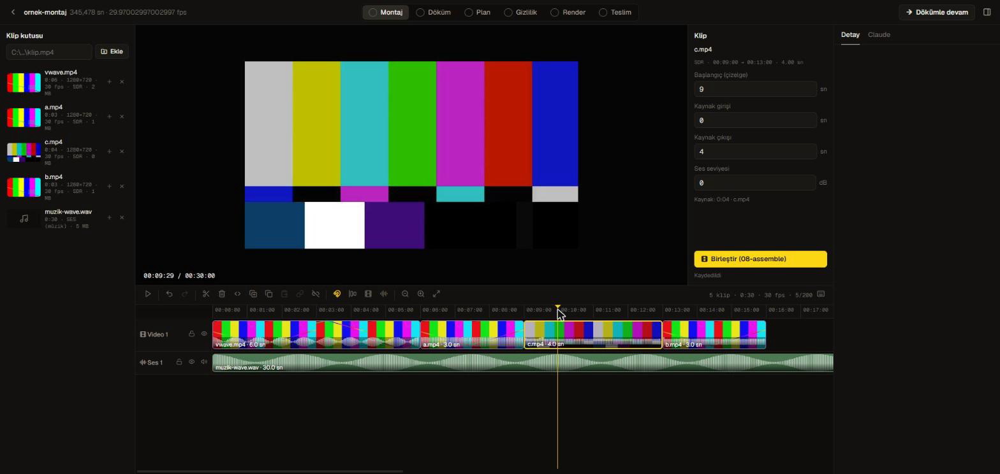

# Montaj (çoklu klip)

Panelin **Montaj** aşaması birden çok klibi tek zaman çizelgesinde birleştirir. Çıktısı, kurgu hattının zaten bildiği iki dosyadır:
`work/assemble.json` (video parçaları → `scripts/08-assemble.mjs`) ve `work/audio/selection.json` içindeki `musicPlace` (müzik → `scripts/75-audio.mjs`).
Montaj kullanmadan tek `public/main.mov` ile çalışmaya devam edebilirsin; bu aşama isteğe bağlıdır.



## Akış

1. **Klip kutusu**: birleştirmek istediğin dosyaların tam yolunu yapıştır (Dosya Gezgini → Shift+sağ tık → *Yol olarak kopyala*) ve **Ekle**'ye bas. Dosyalar kopyalanmaz, özgün hâlleri değişmez.
2. Kutudaki **+** ile klibi zaman çizelgesine ekle (video: video izinin sonuna, ses: oynatma kafasının olduğu saniyeye).
3. Taşı, kırp, böl, sil; boşlukları kapat; gerekirse müzik ekle.
4. **Birleştir (08-assemble)**: `work/composite/base.mov` üretilir, `work/project.json → source` buna işaret eder, `probe` yeniden çalışır. Sonra **Döküm** aşamasından devam edilir (döküm, plan ve render bu birleşik tabana göre yapılır).

Zaman çizelgesi her değişiklikte `work/montage.json`'a kaydedilir; panel yeniden açılınca geri gelir. Geri al geçmişi (en fazla 200 adım) kayıtlı değildir.

## Klipler

| | Kural |
|---|---|
| Video | `.mp4 .mov .mkv .m4v .webm .avi .mts`. Tür otomatik okunur: HLG → `hlg`, diğerleri → `sdr`. **PQ (HDR10) reddedilir** |
| Ses (müzik) | `.mp3 .wav .m4a .aac .flac .ogg .aif .aiff` |
| Kare hızı | Hat ilk klibin kare hızını alır; **farklı kare hızlı klip eklenemez** (hata verir) |
| Boyut | HLG klipler 16:9 olmalı; 4K değilse 4K'ya ölçeklenir. SDR klipler 4K'ya ölçeklenir ve HLG tabana yükseltilir; **tüm klipler SDR ise çıktı SDR kalır**. 16:9 olmayan SDR kaynaklarda sonucu elle kontrol et: `08-assemble` yalnız genişliği 16 px'e hizalar, `assemble.json → crop` alanını Montaj arayüzü sunmuyor |
| Disk | Dosya proje ile **aynı sürücüde** olmalı (`assemble` göreli yol kullanır) |
| Boşluk | Video izinde klipler arasında boşluk varsa **Birleştir** hata verir; **Boşlukları kapat** düğmesini kullan |

## Zaman çizelgesi

Üstte video izi, altta ses izi. İz başında kilit, göz (gizle) ve (ses izinde) sessize al düğmesi var. Kilitli iz taşınmaz/kırpılmaz/silinmez.

| Kısayol | İş |
|---|---|
| **Boşluk** | Oynat / durdur |
| **← / →** | 1 kare geri/ileri (Shift: 1 sn) · **Home / End**: başa / sona |
| **S** | Oynatma kafasından böl (seçili klip varsa yalnız onları) |
| **Delete** | Sil · **Shift+Delete**: ripple sil (sağdaki klipler boşluğu kapatır) |
| **Ctrl+D** | Çoğalt (aynı izde hemen sonrasına) |
| **Ctrl+C / Ctrl+V** | Kopyala / oynatma kafasına yapıştır |
| **Ctrl+A** | Hepsini seç |
| **Ctrl+G / Ctrl+Shift+G** | Grupla / grubu çöz (grup birlikte taşınır, bölünür, silinir) |
| **Ctrl+Z / Ctrl+Y** | Geri al / yinele |
| **M** | Mıknatısı aç/kapat (klip kenarları, oynatma kafası, 0) |
| **Z** | Oynatma kafasına zoom (punch-in) ekle (2 sn, 1,12×) |
| **Ctrl+tekerlek** | İmleç noktasında yakınlaştır |
| **Shift/Ctrl+tık** | Seçime ekle/çıkar · boşlukta sürükle: kutu seçimi |
| **?** | Kısayol penceresi |

Kenarlardan sürükleyerek kırpılır (kaynak dosyanın başından/sonundan öteye açılmaz). Seçili klibin başlangıç, kaynak giriş/çıkış ve ses seviyesi sağ paneldeki alanlardan sayıyla da girilebilir.

## Kamera (zoom / punch-in)

Sağ paneldeki **Kamera (zoom)** bölümünde (ya da **Z** ile) çıkış zaman çizelgesine zoom eklenir; her zoom başlangıç/bitiş (sn), ölçek (1,01–2,5×), yatay/dikey odak (0–1) ve giriş/çıkış rampası (sn; 0 = kesme anında sert) alanlarıyla düzenlenir. **Birleştir** bunları `assemble.json → zooms` olarak yazar; `08-assemble.mjs` her kareye tek ölçek+kırpma uygular (smoothstep rampa).

- Zaman çizelgesinin altındaki **Kamera** satırında zoom'lar çubuk olarak görünür: gövdeden sürükle = taşı, kenardan sürükle = kırp (kare ızgarası, en az 0,1 sn), tık = seç ve kafayı başına götür, **Delete** = seçili zoom'u sil, **Ctrl+D** = hemen sonrasına çoğalt, Ctrl+Z geri alır.
  - **Mıknatıs (M)** zoom çubuklarında da çalışır: klip kenarlarına, oynatma kafasına, 0'a ve diğer zoom'ların kenarlarına yapışır (taşırken başı ya da sonu, hangisi yakınsa; çizgi görünür).
  - Üst üste binen zoom'lar ayrı şeritlere dizilir, hepsi tutulabilir. Çakışan zoom'lar **toplanır** (iki 1,12× yaklaşık 1,24× verir); bilerek istenmiyorsa ayır.
  - Videonun bittiği yerden sonra kalan zoom taralı ve kesik çerçeveli görünür ("dışarıda"): Birleştir'de atılır. Sonu videoyu aşan zoom'un fazlası kırpılır. Oynatma kafası videonun sonundayken **Z** zoom eklemez.
  - Sürüklerken önizleme (kırpma) anında güncellenir. Çubuğun uçlarındaki koyu geçiş giriş/çıkış rampasını gösterir.
- Önizleme aynı formülle (`zoomAt`) kırpar; kadraj merkezi odak noktasıdır ve kare dışına çıkmaz.
- Zoom'lar **çıkış süresine** bağlıdır, kliplere değil: klip taşıyınca/silince zoom yerinde kalır, elle kaydır. Çıkış süresinden sonra kalan kısım Birleştir'de kırpılır, tamamen dışarıda kalan atılır.
- **Ölçüldü** (sentetik 720p SDR klip → 4K, `08-assemble` gerçek çalıştırıldı): kadraj beklenen kırpmayla eşleşiyor. 1,5× ortada 19,6 dB, 1,12× sağ-üste yaslı 21,1 dB (zoom'suz kare 24,4 dB; fark kaynağın 4K'ya ölçeklenmesinden gelen yumuşaklık). Gerçek bir **4K60 HEVC 10-bit HLG + Dolby Vision 8.4** akışıyla da (iPhone'un biçimi; Jellyfin test videosu, içeriği soyut bir animasyon, kamera görüntüsü değil) denendi: 360/360 kare, çıktı etiketleri `bt2020 / arib-std-b67`, DV atılmış; 1,5× ortada 59,8 dB, 1,12× sağ-üste yaslı 40,5 dB (zoom'suz 62,7 dB). İnsan yüzü/cilt tonu içeren gerçek kamera klibiyle denenmedi.
- Bu ölçüm `08-assemble.mjs`'teki eski bir hatayı yakaladı: zoom t=0'da 1× başladığında kadraj ortada değil sol-üst köşede kalıyordu (`crop`'un `iw/ih`'ı ilk boyutta takılıyor; 2,7 dB). Kadraj artık `scale` ile aynı t-ifadesinden hesaplanır. Eski `assemble.json → zooms` dosyaları aynı şekilde yeniden birleştirilirse düzelir.

## Müzik klibi

Ses izine eklenen müzik klibi **başlangıç saniyesi**, **kaynak giriş/çıkışı** ve **dB** ayarıyla yerleşir. Hat tek müzik stem'i kurduğu için:

- ses izinde **en fazla bir klip** olabilir (ikincisi **Birleştir**'de hata verir; izi susturmak klibi yok sayar),
- Birleştir bunu `work/audio/selection.json` → `musicPlace {start, in, out, gainDb}` ve `music` alanlarına yazar,
- `scripts/75-audio.mjs` müziği kesip videonun o saniyesine koyar, fade'leri kesite göre yapar, konuşmaya göre ducking ve seviye eşleştirme eskisi gibi çalışır,
- müzik klibi yoksa `musicPlace` silinir, `music` alanına dokunulmaz. `musicPlace` yoksa hat eskisiyle **birebir aynı** çalışır (testle doğrulandı).

Ses efektleri (whoosh, tick…) hâlâ kurgu planından üretilir; zaman çizelgesinde efekt klibi yoktur.

## Önizleme

Her video klibi için sunucu arka planda **640 px H.264 proxy** üretir (yalnız önizleme; teslime girmez):

- **60 sn'lik parçalar** hâlinde, sırayla. İlk parça hazır olunca oynatma başlar; klip kutusunda `proxy 2/6` gibi ilerleme görünür.
- Çözme `-hwaccel auto` ile donanımdadır (Windows'ta d3d11va), başarısız olursa yazılıma düşer.
- **Ölçülen** (RTX 3050 Ti laptop, 5 dk 14 sn 4K HEVC): ilk parça ~22 sn, tamamı ~116 sn, toplam ~19 MB.
- **Tek ffmpeg** çalışır. İkinci işçi toplamı yalnız %7 azalttı ama RAM'i 2,5 GB'a çıkardı; artırmak için `KURGU_PROXY_WORKERS=2` (en çok 4; boş RAM 2,5 GB altındaysa yine 1).
- **HLG renkleri** projenin kendi `work/luts/hlg_to_sdr709_preview.cube` LUT'uyla SDR'a çevrilir (yoksa `scripts/40-make-luts.mjs` ile üretilir; olmazsa eski kaba `eq` yaklaşığı). SDR kareyi HLG'ye yükseltip geri çevirerek ölçüldü: LUT 24,6–25,3 dB (proxy sıkıştırması dahil), eski `eq` 21,0–21,5 dB. Bu bir **görüntüleme** dönüşümüdür, renk için referans değildir.
- Zaman çizelgesi şeritleri ve önizleme karesi proxy hazırsa proxy'den çıkar (8 kare 9,5 sn yerine 0,63 sn). Ses klibinde ve sesli video kliplerde dalga formu çizilir.
- Önizleme **gerçek zamanlı oynatmadır ama kare-kesin değildir**: video ve müzik çizelge saatine bağlanır, 0,4 sn'den fazla sapınca yeniden konumlanır (ölçülen müzik sapması ortalama 0,03 sn).

## Birleştirme çıktısı

`work/composite/base.mov` **ProRes 422 HQ 10-bit** ve PCM sestir; kayıpsıza yakın olduğu için **büyüktür**: ölçülen ~90 MB/sn (4K 50 fps'te 12,2 sn → 1,1 GB), yani 5 dakikalık bir kurgu yaklaşık **27 GB** tutar (bu bir çıkarımdır, 5 dakikalık birleştirme denenmedi). Ölçülen süre: 12,2 sn'lik 4K 50 fps çıktı 71 sn. Başlamadan önce diskini kontrol et.

- **Sessiz kaynak** (ses akışı olmayan klip, ör. sessiz ekran kaydı) desteklenir: o parça için aynı sürede sessizlik eklenir (`ses akışı yok → sessizlik eklendi`). Eskiden filtre grafiği `matches no streams` ile çöküyordu.
- Parçalar arasında 12 ms'lik fade vardır (kesişimde tık olmaz). Konuşma yalnız kesilir; seviye değiştirilmez.
- **Birleştir `project.source`'u değiştirir.** Montajı terk edip tek `main.mov`'a dönmek için `work/project.json`'dan `source` satırını silip `npm run probe` çalıştırmak yeterlidir.
- Birleştirme render çalışırken başlatılamaz.

## Bilinen sınırlar

- Ses senkronu ve ses kalitesi **kulakla doğrulanmadı**; yalnız zaman ve seviye ölçüldü (gecikme 0,00 ms, seviye farkı 0,00 dB).
- Zoom'lar çizelge saniyesine bağlıdır (kliple birlikte kaymaz).
- Tek müzik klibi. Efekt/ses klibi yok.
- Proxy'de HLG rengi yaklaşıktır; PQ kaynak desteklenmez. Gerçek 4K60 HLG+DV 8.4 akışında proxy 36 sn'de hazır oldu (LUT üretimi dahil). Projenin kuralına (SDR beyazı = 203 nit, kırpmalı `zscale` dönüşümü) göre: LUT 24,4 dB, eski `eq` 19,5 dB, ham yorum 17,5 dB; proxy'nin kendi tam çözünürlüklü LUT karşılığına uzaklığı 29,5 dB (H.264 640 px kaybı). Referans projenin kuralıdır, mutlak doğru değil; başka bir kural (ör. 1000 nit) seçilirse sıralama değişir. Kamera içeriğinde (cilt tonu) denenmedi.
- Çok uzun klipte proxy dakikalar sürer; o sürede önizleme küçük resimle devam eder.

## Dosyalar

| Dosya | İçerik |
|---|---|
| `work/montage.json` | Zaman çizelgesi (klipler, izler) |
| `work/montage-bin.json` | Klip kutusu (kaynak yolları, süre, tür) |
| `work/assemble.json` | `08-assemble`'ın girdisi (Birleştir yazar) |
| `work/montage-audio.json` | Müzik klibi → `selection.json`'a birleştirilir |
| `work/montage-build.json` · `work/logs/assemble.log` | Birleştirme durumu / günlüğü |
| `work/montage-proxy/` · `montage-thumbs/` · `montage-wave/` | Önizleme önbellekleri (silinebilir) |

## Testler

```powershell
npm run test:unit      # timeline motoru, Montaj sunucusu, gizlilik, ses yerleşimi, 08-assemble (sessiz kaynak + zoom kadrajı) dahil
```

Motor (`studio/timeline/engine.mjs`) DOM'suzdur ve doğrudan Node'da test edilir; Montaj sunucusu testleri gerçek `ffprobe`/`ffmpeg` ile küçük sentetik kliplerde çalışır (ffmpeg yoksa atlanır).
